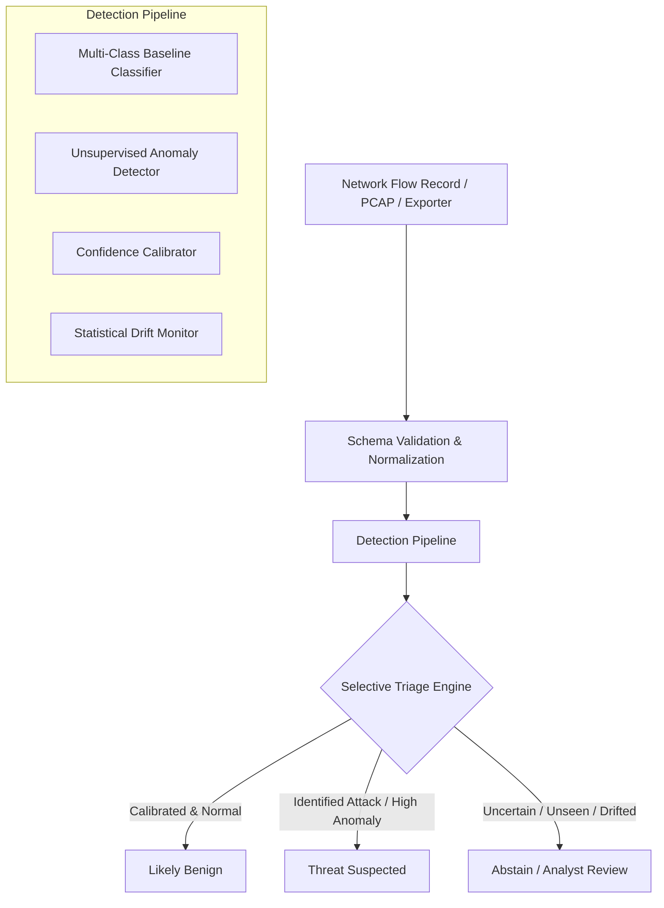

# TraceGuard — Adaptive Network Threat Detection

> **Stage 1: Project Foundation**  
> A cybersecurity + machine learning project investigating how an adaptive network intrusion detector handles unfamiliar zero-day attacks, changing traffic distributions, class imbalance, and predictive uncertainty.

---

## 1. Project Purpose & Research Question

Traditional Network Intrusion Detection Systems (NIDS) frequently rely on standard multi-class classifiers evaluated on synthetic benchmark datasets using raw accuracy. Under realistic conditions, they fail in two critical ways:
1. **Unseen Zero-Day Attacks:** New or mutated attack variants that were not in the training set are silently misclassified as benign traffic.
2. **Traffic & Concept Drift:** Changing network environments cause statistical feature distributions to shift, degrading detector reliability without warning.

### Core Research Question

> **"Can TraceGuard detect threats reliably when attack categories are unseen or network traffic changes, and can it recognize when it should not trust its own prediction?"**

TraceGuard addresses this by coupling a baseline multi-class classifier with **unsupervised anomaly detection (Isolation Forest)**, **confidence calibration (Platt/Isotonic scaling)**, and a **selective prediction (abstention) mechanism**. Rather than forcing a binary or uncalibrated decision on ambiguous traffic, TraceGuard implements a three-way triage policy:
- **Likely Benign:** High calibrated confidence, low anomaly score.
- **Threat Suspected:** High calibrated confidence in a known attack class, or significant anomaly score.
- **Abstain (Review Required):** Elevated prediction uncertainty, out-of-distribution traffic, or significant feature drift. The flow is safely routed to SOC security analysts for manual review.

---

## 2. System Architecture



### Stack Choices & Rationale
- **Backend:** [FastAPI](https://fastapi.tiangolo.com/) (Python 3.12, asynchronous ASGI core, high throughput for network telemetry), [Pydantic v2](https://docs.pydantic.dev/) (strict typing, schema validation, defense against malformed packets).
- **Frontend:** [React 19](https://react.dev/), [TypeScript](https://www.typescriptlang.org/), [Vite](https://vite.dev/) (fast compilation, typed contracts, responsive cybersecurity dark mode interface).
- **ML Architecture (Stages 3–4):** [scikit-learn](https://scikit-learn.org/), [pandas](https://pandas.pydata.org/), [NumPy](https://numpy.org/).
- **Testing:** [pytest](https://docs.pytest.org/) & `httpx` for backend API tests; [Vitest](https://vitest.dev/) & React Testing Library for frontend component tests.
- **Security Guardrails:** The API strictly distinguishes between health checks, unconfigured models, and inference. In Stage 1, requests to `/api/model/predict` return HTTP 503 rather than faking detections.

---

## 3. Project Directory Structure

```text
TraceGuard/
├── backend/
│   ├── app/
│   │   ├── api/
│   │   │   ├── routes/
│   │   │   │   ├── health.py        # System health & readiness probes
│   │   │   │   ├── model.py         # Model lifecycle status & inference guardrails
│   │   │   │   └── telemetry.py     # Drift telemetry & evaluation endpoints
│   │   │   └── router.py            # API router aggregating routes under /api
│   │   ├── core/
│   │   │   ├── config.py            # Typed Pydantic BaseSettings (.env integration)
│   │   │   └── logging.py           # Structured logging setup
│   │   ├── schemas/
│   │   │   ├── health.py            # Health & readiness contracts
│   │   │   ├── model.py             # Model status & prediction contracts
│   │   │   └── telemetry.py         # Drift & benchmark metrics schemas
│   │   └── main.py                  # FastAPI application entrypoint with CORS & logging
│   ├── tests/
│   │   ├── conftest.py              # Test client fixtures (pytest-asyncio)
│   │   ├── test_health.py           # Health endpoint tests
│   │   ├── test_model.py            # Model status & 503 guardrail tests
│   │   └── test_telemetry.py        # Telemetry & evaluation empty-state tests
│   ├── requirements.txt             # Production dependencies
│   └── requirements-dev.txt         # Dev & test dependencies
├── data/
│   ├── raw/                         # Raw PCAP/CSV files (ignored in git)
│   ├── processed/                   # Cleaned, encoded splits (ignored in git)
│   └── README.md                    # Stage 2 dataset evaluation criteria
├── frontend/
│   ├── src/
│   │   ├── components/
│   │   │   ├── Header.tsx           # Live status badge & refresh trigger
│   │   │   ├── Navigation.tsx       # 5 core module tabs
│   │   │   ├── ModelStatusBanner.tsx# Status banner & interactive probe harness
│   │   │   ├── OverviewTab.tsx      # System matrix, research question, roadmap
│   │   │   ├── TrafficTab.tsx       # 20-feature schema table & empty state
│   │   │   ├── ThreatsTab.tsx       # Tri-state triage policy & API probe
│   │   │   ├── EvaluationTab.tsx    # Scientific benchmark methodology
│   │   │   └── DriftTab.tsx         # Covariate shift & concept drift protocols
│   │   ├── services/
│   │   │   └── api.ts               # Typed client calling backend API
│   │   ├── test/
│   │   │   └── App.test.tsx         # Vitest unit test suite (7 tests)
│   │   ├── types/
│   │   │   └── api.ts               # TypeScript interfaces
│   │   ├── App.tsx                  # Main dashboard container
│   │   ├── index.css                # Professional cybersecurity dark theme
│   │   └── main.tsx                 # React entrypoint
│   ├── index.html                   # SEO-optimized title & font headers
│   ├── package.json                 # Node dependencies & scripts
│   ├── tsconfig.json                # TypeScript compiler config
│   ├── vite.config.ts               # Vite bundler with /api proxy
│   └── vitest.config.ts             # Vitest test runner config
├── ml/
│   ├── README.md                    # ML roadmap and pipeline specifications
│   ├── __init__.py
│   └── schemas.py                   # 20 standardized flow features & decisions
├── models/
│   └── artifacts/                   # Serialized model weights (ignored in git)
├── .env.example                     # Environment template
├── .gitignore                       # Multi-tier ignore rules (Python, Node, Data, Models)
├── pytest.ini                       # Pytest configuration (asyncio mode = auto)
└── README.md                        # Project documentation
```

---

## 4. Standardized Network Flow Schema

TraceGuard inspects network communications at the flow level using 20 features:

| Feature Name | Type | Description |
| :--- | :--- | :--- |
| `flow_id` | string (opt) | Flow identifier or hash |
| `protocol` | int [0–255] | IP protocol number (e.g., 6 = TCP, 17 = UDP, 1 = ICMP) |
| `flow_duration_ms`| float (>= 0) | Duration of the flow in milliseconds |
| `src_port` / `dst_port` | int [0–65535]| Source and destination transport ports |
| `total_fwd_packets` | int (>= 0) | Packet count in forward direction |
| `total_bwd_packets` | int (>= 0) | Packet count in backward direction |
| `total_fwd_bytes` | int (>= 0) | Volume of forward payload in bytes |
| `total_bwd_bytes` | int (>= 0) | Volume of backward payload in bytes |
| `fwd_packet_length_mean` | float (>= 0) | Mean length of forward packets (bytes) |
| `bwd_packet_length_mean` | float (>= 0) | Mean length of backward packets (bytes) |
| `flow_bytes_per_sec` | float (>= 0) | Byte transfer rate per second |
| `flow_packets_per_sec` | float (>= 0) | Packet rate per second |
| `flow_iat_mean` / `std` | float (>= 0) | Inter-arrival time mean and std deviation (ms) |
| `syn_flag_count` | int [0, 1] | TCP SYN flag |
| `rst_flag_count` | int [0, 1] | TCP RST flag |
| `ack_flag_count` | int [0, 1] | TCP ACK flag |
| `fin_flag_count` | int [0, 1] | TCP FIN flag |

---

## 5. Prerequisites

- **OS:** Windows 10/11 (or Linux / macOS)
- **Python:** 3.10+ (tested on Python 3.12.10)
- **Node.js:** v18+ (tested on Node v25.9.0, npm 11.12.1)
- **Git:** Git for Windows (v2.54+)

---

## 6. Exact Setup and Run Commands (Windows PowerShell)

### Step 1: Clone / Enter Directory
```powershell
cd C:\Users\Abdul\Desktop\Trace
```

### Step 2: Configure Environment Variables
```powershell
Copy-Item .env.example .env
```

### Step 3: Set Up Python Backend
```powershell
# Create virtual environment (if not already created)
python -m venv .venv

# Activate virtual environment
.\.venv\Scripts\Activate.ps1

# Install backend dependencies
pip install -r backend\requirements-dev.txt
```

### Step 4: Run Backend Server
```powershell
.\.venv\Scripts\uvicorn backend.app.main:app --host 127.0.0.1 --port 8000 --reload
```
*Backend API will be running at:* `http://127.0.0.1:8000`  
*Swagger Documentation:* `http://127.0.0.1:8000/api/docs`

### Step 5: Set Up Frontend (In a new terminal window)
```powershell
cd C:\Users\Abdul\Desktop\Trace\frontend

# Install dependencies
npm install

# Start development server
npm run dev
```
*Frontend interface will be available at:* `http://127.0.0.1:5173/`

---

## 7. How to Run Automated Tests

### Run Backend Tests (Pytest)
```powershell
cd C:\Users\Abdul\Desktop\Trace
.\.venv\Scripts\pytest backend\tests -v
```
**Observed Result:** 8 of 8 tests pass (100%), including health checks, readiness probes, root endpoint, and model status/503 guardrail verification.

### Run Frontend Tests (Vitest)
```powershell
cd C:\Users\Abdul\Desktop\Trace\frontend
npm test
```
**Observed Result:** 7 of 7 tests pass (100%), verifying header badges, navigation tabs, empty states, and tab-switching interactions.

### Run Frontend Production Build & TypeScript Check
```powershell
cd C:\Users\Abdul\Desktop\Trace\frontend
npm run build
```
**Observed Result:** Compiled with 0 errors via `tsc -b && vite build`.

---

## 8. Current Implementation Status (Stage 1)

| Area | Status | Notes |
| :--- | :--- | :--- |
| **API Server** | Completed | FastAPI async engine with CORS, logging, and health probes |
| **Data Contracts** | Completed | 20-feature flow record, decisions, and abstention reasons typed in Pydantic & TypeScript |
| **Model Guardrail** | Completed | Reports `UNCONFIGURED`; returns HTTP 503 rather than faking detections |
| **Frontend Shell** | Completed | Dark navy cybersecurity UI with 5 functional navigation tabs |
| **Test Suites** | Completed | 8 backend tests + 7 frontend tests passing with 0 failures |
| **ML Models** | Unconfigured | Scheduled for Stages 3–4 (as required by Stage 1 boundary) |
| **Datasets** | Not Downloaded| To be evaluated and selected in Stage 2 |

---

## 9. Known Limitations

1. **No Trained Weights (By Design):** The detection engine is explicitly unconfigured. Calling the inference endpoint validates schemas but safely returns HTTP 503 until models are trained in Stage 3.
2. **Static Empty States:** Traffic analysis, threat streams, and drift telemetry display explanatory empty states because live network flow capture and dataset replay have not been integrated yet.
3. **Local In-Memory Evaluation:** A persistent database (e.g., PostgreSQL or SQLite) has intentionally not been introduced in Stage 1 to prevent unnecessary complexity before dataset selection.

---

## 10. Next Steps: Stage 2 (Dataset Selection & Exploration)

In Stage 2, we will:
1. Compare candidate public intrusion datasets:
   - **CIC-IDS2017 / CSE-CIC-IDS2018:** Rich multi-day attack scenarios, but requires cleaning synthetic packet artifacts.
   - **UNSW-NB15:** Realistic background traffic and modern attack vectors, suitable for zero-day holdout.
   - **NF-UQ-NIDS-v2:** NetFlow-format standardized representation.
2. Inspect class distributions and quantify severe class imbalance.
3. Establish a leakage-resistant train/validation/test split protocol (preventing session overlap across splits).
4. Withhold specific attack categories (e.g., Botnet or Infiltration) as a dedicated zero-day evaluation split for Stage 4.
