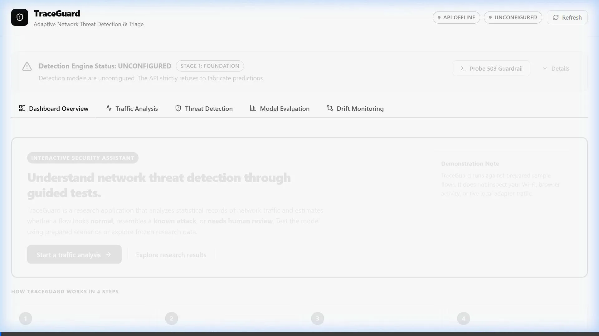
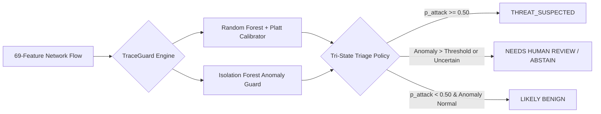
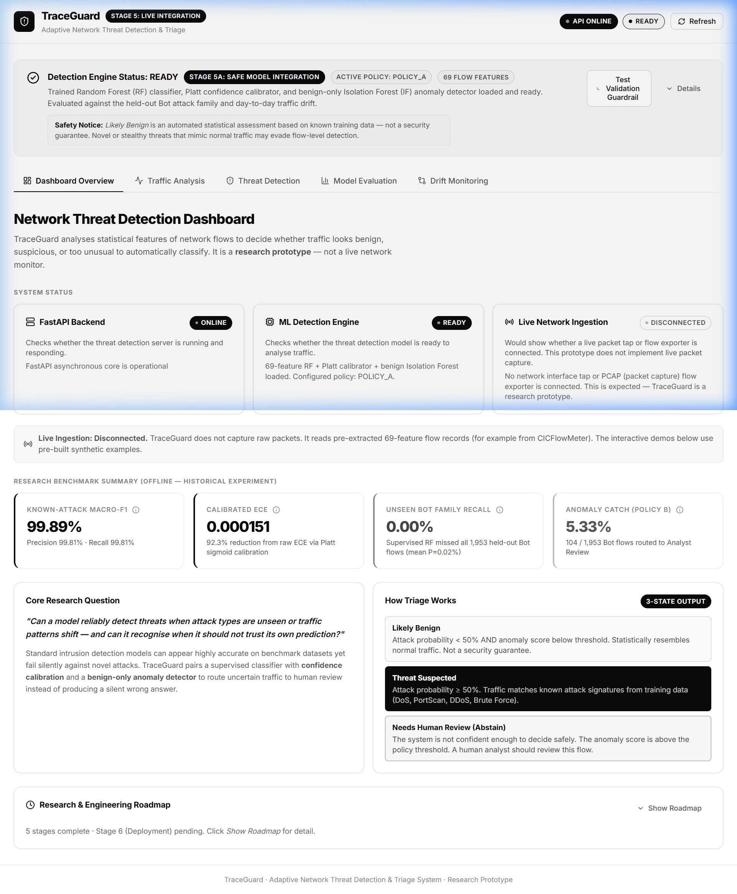
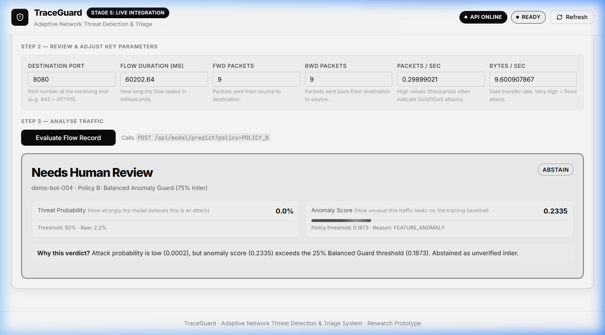
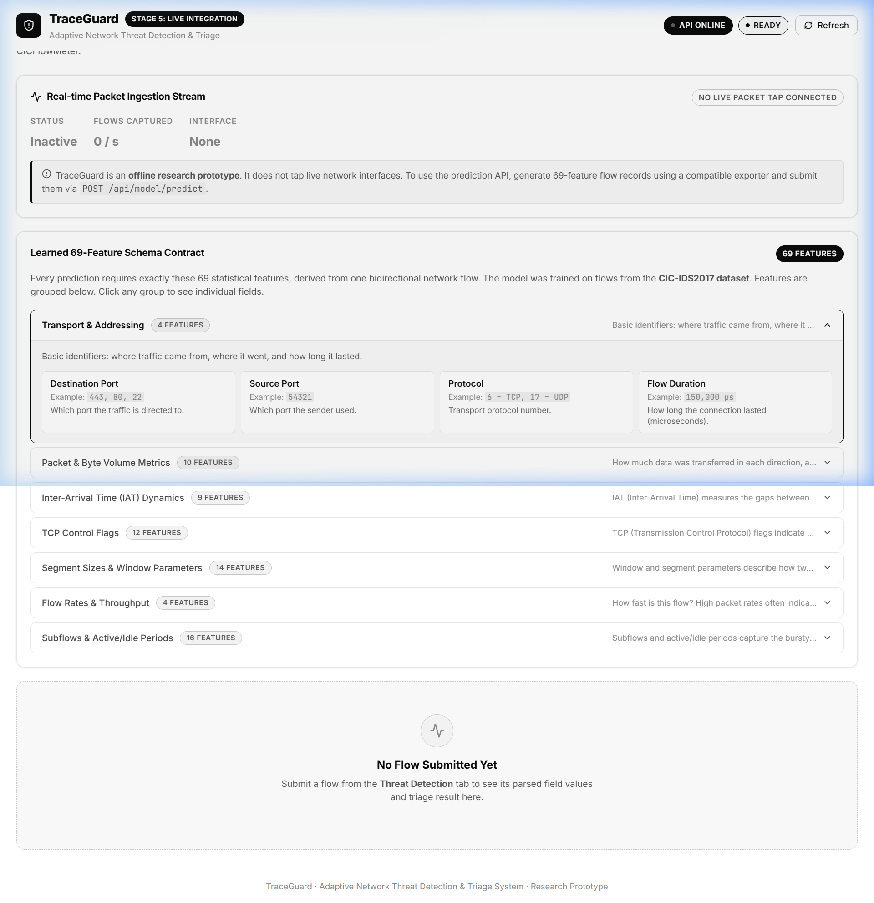
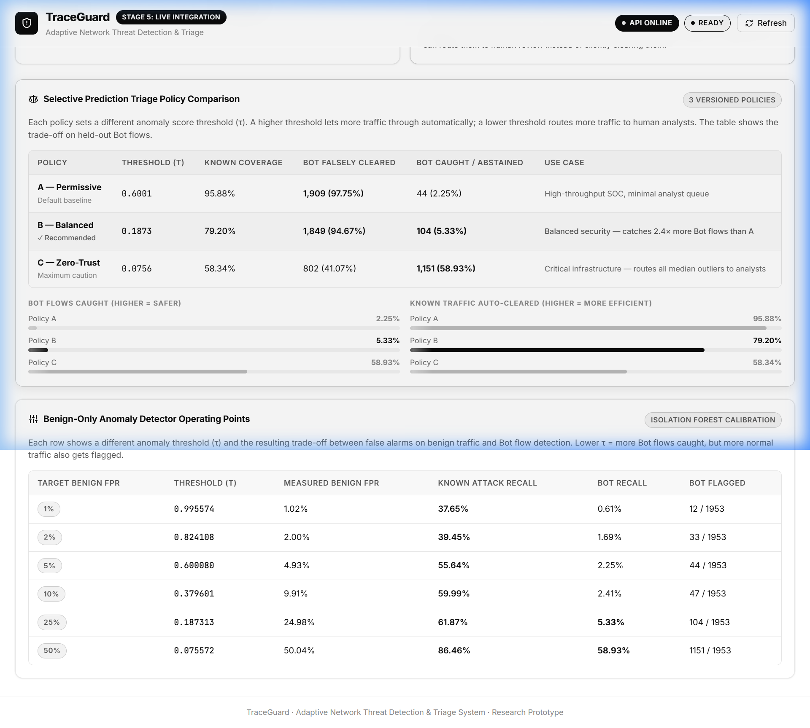
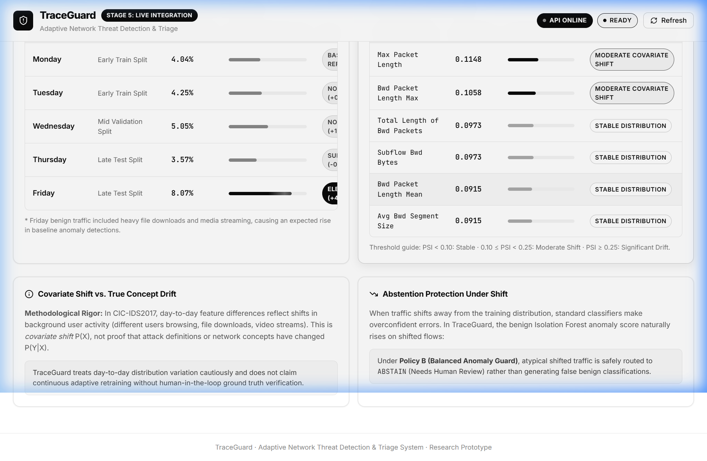

<div align="center">

# 🛡️ TraceGuard
### Adaptive Network Threat Detection & Tri-State Selective Triage

*A modern, minimal, research-grade network security assistant combining supervised classification, confidence calibration, and unsupervised anomaly detection.*

[](https://www.python.org/)
[](https://fastapi.tiangolo.com/)
[](https://react.dev/)
[](https://www.typescriptlang.org/)
[](https://vite.dev/)
[](https://docs.pytest.org/)
[](LICENSE)

<br/>

<div align="center">
  
  <p><em>🎥 <b>Interactive Demonstration:</b> Starting Page → Normal Flow → Known DoS → Unseen Botnet Anomaly Abstention → Policy Switching</em></p>
</div>

<br/>

<p align="center">
  <a href="#-quick-tour--guided-workflow">Quick Tour</a> •
  <a href="#-the-core-problem--why-traceguard">Why TraceGuard?</a> •
  <a href="#-how-it-works-in-4-steps">How It Works</a> •
  <a href="#-empirical-research-findings">Research Findings</a> •
  <a href="#-quick-start">Quick Start</a> •
  <a href="#-system-architecture">Architecture</a>
</p>

</div>

---

> [!NOTE]
> **What TraceGuard Does:** TraceGuard is a research application that analyzes statistical records of network traffic and determines whether a flow looks **normal**, resembles a **known attack**, or **needs human review**. It operates on curated 69-feature flow vectors rather than live Wi-Fi or packet capture.

---

## 🎬 Live Walkthrough & Interactive Demo Guide

The animated recording above demonstrates TraceGuard's end-to-end interactive workflow in real time:

1. **Dashboard Initialization**: Verified real-time operational status for the FastAPI backend (`http://127.0.0.1:8000`) and the ML detection engine (`69-feature Random Forest + Platt Calibrator + Isolation Forest`).
2. **Scenario 1 — Normal Web Traffic**: Flow record `demo-benign-001` evaluated. Returns **`LIKELY_BENIGN`** with low calibrated attack probability ($0.03\%$) and normal anomaly score ($0.0432$).
3. **Scenario 2 — Known Denial-of-Service Attack**: Flow record `demo-dos-002` evaluated. Returns **`THREAT_SUSPECTED`** with $100.0\%$ calibrated attack probability.
4. **Scenario 3 — Held-out Unseen Botnet (ARES)**: The supervised classifier alone missed this flow entirely (calibrated $P=0.02\%$). Under **Policy B (Balanced)**, the unsupervised Isolation Forest anomaly guard detects the atypical statistical signature ($s = 0.2335 > \tau = 0.1873$) and issues a **`NEEDS_HUMAN_REVIEW`** (`ABSTAIN`) triage verdict.
5. **Real-Time Policy Comparison**:
   - Switching to **Policy A (Permissive, $\tau=0.6001$)** flips the decision to `LIKELY_BENIGN`, demonstrating why low-vigilance models silently miss novel attacks.
   - Restoring **Policy B (Balanced, $\tau=0.1873$)** immediately restores the safe human-review hold.
6. **Feature Contract & Empirical Audits**: Exploration of the 69-feature schema groups, frozen Stage 4.1 evaluation metrics ($99.89\%$ Macro-F1), and Population Stability Index drift tables ($67/69$ features stable).

---

## ⚡ The Core Problem — Why TraceGuard?

Traditional Machine Learning intrusion detectors boast **>99% accuracy** on benchmark datasets. But in realistic production environments, they fail in two catastrophic ways:

1. **Unseen Zero-Day Attacks:** Novel attack variants excluded from training are silently misclassified as normal benign traffic.
2. **Traffic & Covariate Shift:** Changing day-to-day user activity distorts feature distributions, producing overconfident false alarms.

### TraceGuard's Dual-Engine Answer

Rather than forcing a rigid binary classification, TraceGuard pairs a **calibrated Random Forest** with a **benign-only Isolation Forest anomaly guard**:



| Decision | What It Means | Why It Matters |
| :--- | :--- | :--- |
| **`LIKELY_BENIGN`** | Normal probability and low anomaly score. | Traffic resembles known normal behavior. *(Not an absolute guarantee of safety).* |
| **`THREAT_SUSPECTED`** | Calibrated probability $\ge 50\%$. | High statistical similarity to known attack classes (DoS, PortScan, DDoS). |
| **`NEEDS_HUMAN_REVIEW`** (`ABSTAIN`) | Anomaly score exceeds policy threshold. | System refuses to make an automated guess. Routes atypical flows to human analysts. |

---

## 🗺️ Quick Tour — The 5-Step Guided Journey

The interface is built with a **strict black-and-white minimalist design** and guides users step-by-step through testing the model.

### 1. Dashboard Starting Experience
An approachable starting page with a primary action button, 4-step workflow guide, and subsystem status matrix:

<div align="center">
  
</div>

- **Primary Action**: Click `"Start a traffic analysis →"` to launch the interactive workbench.
- **System Readiness**: Real-time health checks for the FastAPI backend and ML engine.
- **Honest Scope**: Clearly marks Live Ingestion as **Disconnected** (uses exported flow records).

---

### 2. Threat Detection Workbench
The primary interactive tool offering a 5-step guided journey:

<div align="center">
  
</div>

1. **Step 1 — Choose a Scenario**:
   - `Normal Web Traffic`: Tests benign recognition without false alarms.
   - `Known DoS Attack`: Tests how the model handles a trained attack family.
   - `Unseen Botnet Attack`: Demonstrates what happens when a novel Botnet (ARES) attacks.
2. **Step 2 — Select a Triage Policy**:
   - `Policy A (Permissive)`: Fewer review flags ($\tau = 0.6001$), but misses novel attacks.
   - `Policy B (Balanced)`: **Recommended.** Catches $5.33\%$ of unseen Bot flows via anomaly abstention.
   - `Policy C (Conservative)`: Maximum vigilance ($\tau = 0.0756$). Catches $58.93\%$ of Bot flows.
3. **Step 3 — Submit & Analyze**: One prominent button: `"Analyze this traffic (Evaluate Flow Record)"`.
4. **Step 4 — Understand the Result**: Displays the verdict banner, calibrated probability, anomaly score, and explanation.
5. **Step 5 — Explore Further**: One-click policy comparison buttons let you observe in real time how Policy A falsely clears the unseen Bot as benign while Policy B catches it!

---

### 3. Traffic Analysis & 69-Feature Contract
Inspect the exact statistical feature vector required by the detection engine:

<div align="center">
  
</div>

- **7 Feature Groups**: Transport, Packet Volumes, Inter-Arrival Times (IAT), TCP Flags, Segment Sizes, Flow Rates, and Subflows.
- **Strict Guardrail**: Zero silent imputation. The backend rejects partial or malformed vectors with HTTP 422.

---

### 4. Model Evaluation & Research Benchmarks
Inspect the frozen Stage 4.1 empirical research results from the CIC-IDS2017 benchmark:

<div align="center">
  
</div>

- **Known-Traffic Macro-F1**: `99.89%` (FPR $0.038\%$).
- **Held-Out Bot Recall Limitation**: `0.00%` — The supervised classifier alone missed all 1,953 Bot flows, proving why supervised ML alone is insufficient.
- **Platt Calibrated ECE**: `0.000151` ($92.3\%$ error reduction over raw scores).
- **Policy B Anomaly Catch**: **`5.33%`** (104 of 1,953 Bot flows flagged for analyst review).

---

### 5. Drift Monitoring & Covariate Shift
Examine how traffic statistics varied across different recording days (Monday through Friday):

<div align="center">
  
</div>

- **Population Stability Index (PSI)**: 67 of 69 features ($97.1\%$) exhibit negligible shift ($PSI < 0.10$).
- **Daily FPR Variance**: Monday ($4.04\%$) through Friday ($8.07\%$) with grayscale visual distribution bars.
- **Scientific Rigor**: Plain-English distinction between dataset covariate shift $P(X)$ and true concept drift $P(Y|X)$.

---

## 📊 Empirical Research Findings

The table below reconciles the performance of all three triage policies on the held-out Botnet test partition:

| Policy | Anomaly Threshold ($\tau$) | Target Benign FPR | Held-Out Bot Caught for Review | Falsely Cleared as Benign |
| :--- | :---: | :---: | :---: | :---: |
| **Policy A — Permissive** | $0.6001$ | $5.0\%$ | 44 / 1,953 (**2.25%**) | 1,909 (97.75%) |
| **Policy B — Balanced** *(Default)* | $0.1873$ | $25.0\%$ | 104 / 1,953 (**5.33%**) | 1,849 (94.67%) |
| **Policy C — Conservative** | $0.0756$ | $50.0\%$ | 1,151 / 1,953 (**58.93%**) | 802 (41.07%) |

> **Key Takeaway:** All three policies produced zero supervised attack predictions for the held-out Bot flows. Every single Bot flow caught was detected solely through the **benign-only Isolation Forest anomaly detector**.

---

## 🚀 Quick Start

Run TraceGuard locally in three simple steps:

### 1. Prerequisites
- Python 3.12+
- Node.js 18+ & npm

### 2. Backend Setup
```bash
# Clone the repository
git clone https://github.com/abdul78-create/TraceGuard.git
cd TraceGuard

# Activate Python virtual environment and install dependencies
.\.venv\Scripts\activate    # Windows
# source .venv/bin/activate # Linux/macOS
pip install -r backend/requirements.txt

# Start FastAPI server
python -m uvicorn backend.app.main:app --host 127.0.0.1 --port 8000
```

Verify backend health at: [http://127.0.0.1:8000/api/health](http://127.0.0.1:8000/api/health)

### 3. Frontend Setup
In a separate terminal:
```bash
cd frontend
npm install
npm run dev
```

Open your browser at: **[http://localhost:5173/](http://localhost:5173/)**

---

## 🧪 Running Automated Tests

TraceGuard maintains a 100% passing test suite across backend API, ML research, and frontend UI:

```bash
# Run all Python backend & ML research tests (56 tests)
pytest -v

# Run frontend unit & integration tests (7 tests)
cd frontend
npm test

# Verify frontend production build
npm run build
```

---

## 🏛️ System Architecture

```text
TraceGuard/
├── backend/
│   ├── app/
│   │   ├── api/
│   │   │   ├── routes/          # Health, Model Inference, Telemetry
│   │   │   └── sample_flows.json# Curated flow records for demonstration
│   │   ├── schemas/             # Typed Pydantic v2 validation contracts
│   │   ├── services/            # Controlled model loading & triage logic
│   │   └── main.py              # FastAPI application entrypoint
│   └── tests/                   # 26 automated backend tests
├── frontend/
│   ├── src/
│   │   ├── components/          # 5 guided dashboard tabs & UI components
│   │   ├── services/            # Typed API client
│   │   ├── index.css            # Strict monochrome black-and-white design system
│   │   └── test/                # 7 automated Vitest tests
├── ml/
│   ├── preprocessing.py         # Leakage-resistant feature transformation
│   ├── train_baseline.py        # Supervised Random Forest training
│   ├── train_unseen.py          # Isolation Forest & Platt scaling calibration
│   └── tests/                   # 30 automated ML research tests
├── models/artifacts/            # Serialized joblib weights & calibrator
├── reports/                     # Data audits & Stage 4.1 empirical benchmarks
└── docs/media/                  # High-resolution screenshots & demo recording
```

---

## ⚖️ Ethics & Responsible Research Disclosure

- **Scope Limitation**: TraceGuard is an offline research prototype designed to study algorithmic triage, calibration, and anomaly detection. It does not perform kernel-level packet inspection or replace production security tools.
- **Safety Transparency**: The decision `LIKELY_BENIGN` is an automated statistical classification based on known training distributions — it is never represented as an absolute guarantee of traffic safety.
- **No Data Fabrication**: When the backend API is disconnected, the dashboard transparently flags displayed figures as frozen reference baseline data rather than fabricating real-time telemetry.

---

<div align="center">
  <sub>Built for robust, transparent, and interpretable network threat detection.</sub>
</div>
